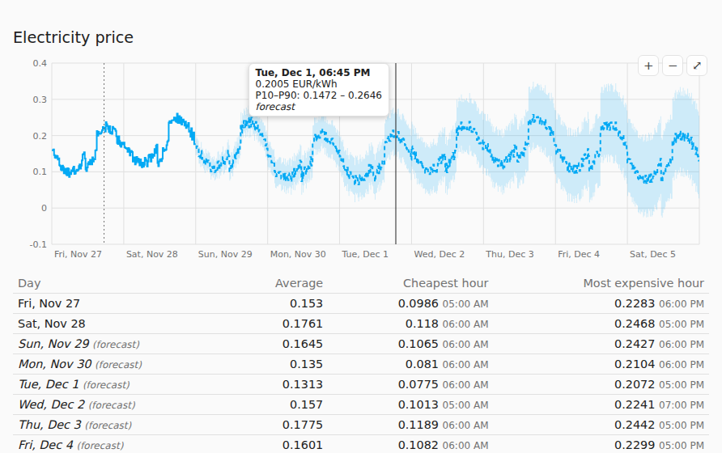
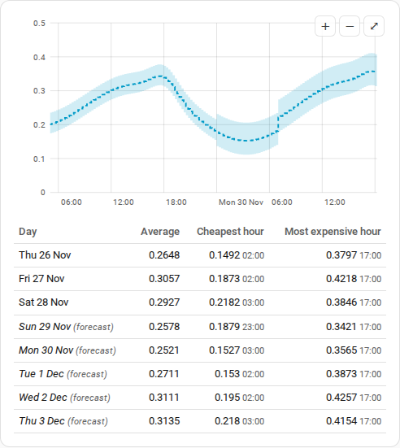
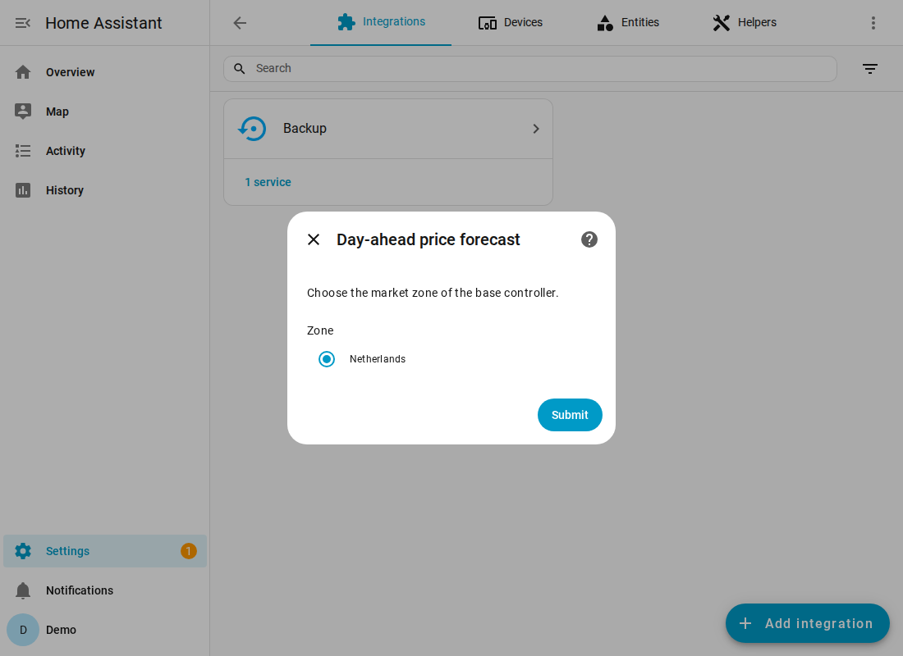
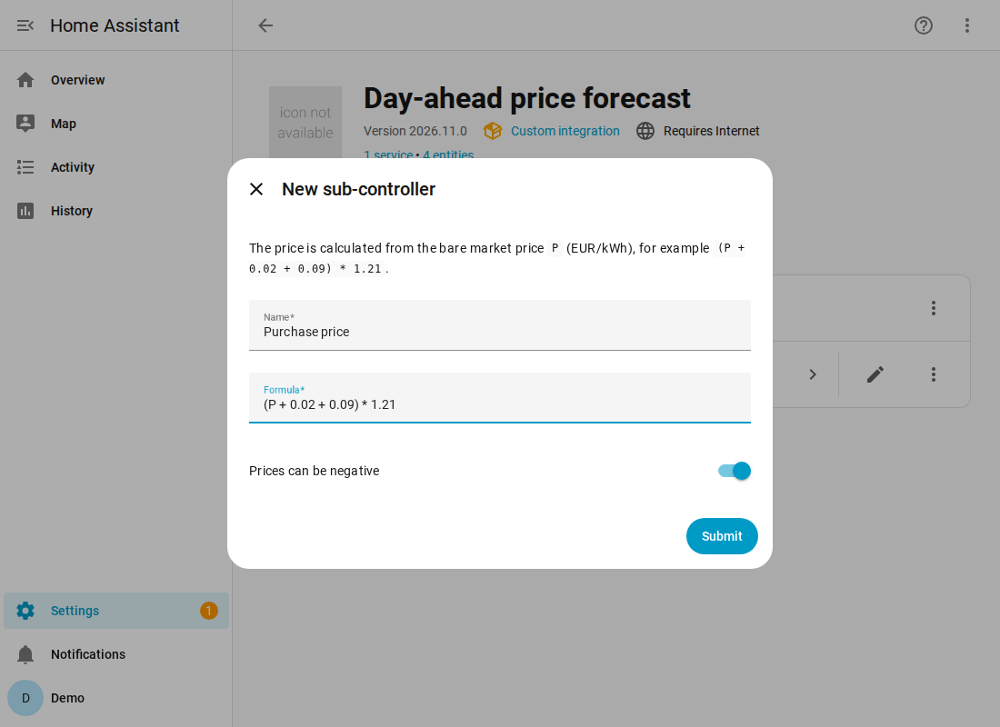
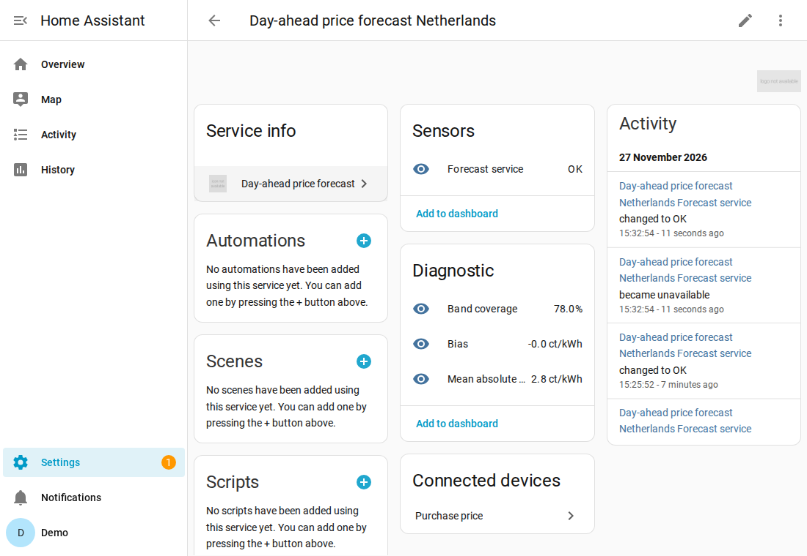

# 7-Day-Ahead Price Forecast

**Know tomorrow's electricity price before it is published, and next week's too.** A Home Assistant integration
that forecasts the day-ahead price **per quarter hour for the 7 days after the last known price day**, with a
P10–P90 uncertainty band, and a Lovelace chart card that shows it.

## Features
- **Seven days ahead, per quarter hour.** The forecast starts where the published day-ahead prices end, so you
  always see the full picture: what is known and what is expected.
- **An honest band.** Every quarter hour has a P10–P90 range, calibrated so that about 80 % of the real prices
  fall inside it. You see how sure the forecast is, not just a line.
- **Your price, not the market price.** Add sub-controllers with your own formula, for example
  `(P + 0.02 + 0.09) * 1.21` for purchase or `P - 0.02` for feed-in. Each one gets its own sensor.
- **Tariff variants.** Formulas by start date, time of day and weekday, ready for dynamic grid tariffs.
- **Chart card included.** Solid line for published prices, dashed line for the forecast, a hairline that follows
  your mouse, a "now" marker and a table with the average and cheapest/most expensive hour per day. Zoom in
  to see every quarter-hour step. Nothing to install separately.
- **Reliable.** Two redundant servers with automatic failover; the sensors keep their last forecast when the
  service is down. No account or API key.
- **Made for automations.** The whole series is an attribute of the sensor: plan the battery, the heat pump or
  the dishwasher on the cheapest hours of the coming days.

## Installation
1. In HACS choose **Custom repositories** and add `https://github.com/abroeders/7day-ahead-price-forecast` as
   category *Integration* (or use the button below), then download **Day-ahead price forecast**.
2. Restart Home Assistant and add the integration under **Settings → Devices & services**.
3. Add a sub-controller with your formula and put the **Day-ahead price forecast** card on a dashboard.

Requires Home Assistant 2026.3 or newer. Currently the Netherlands; more market zones can be added.

  
  
  

## Documentation
**Full user documentation: <https://abroeders.github.io/7day-ahead-price-forecast/>**: installation,
configuration, entities, the chart card, FAQ and the forecast service API.

## Support

If this project is useful to you, please consider buying me a coffee. Your support lets me keep developing it. Thank you!

## License
Apache-2.0
