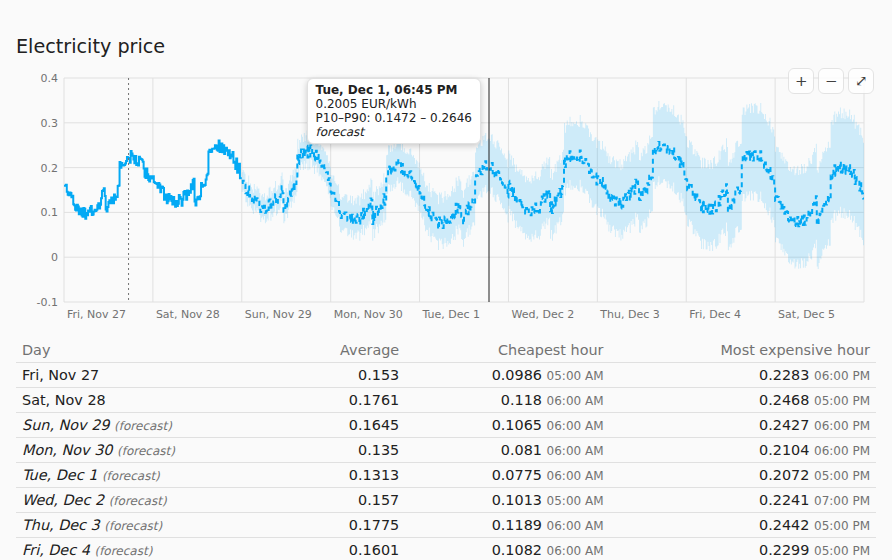

# Day-Ahead Price Forecast

A Home Assistant integration that forecasts the day-ahead electricity price per quarter hour for the **7 days
after the last known price day**, with a **P10–P90 uncertainty band**, and a Lovelace chart card that shows it. The
forecast comes from the forecast module of the Lectoraat Smart Energie of MNEXT. No account or API key is needed.

| Page | What |
|---|---|
| [Installation](installation.md), [Configuration](configuration.md), [Entities](entities.md), [FAQ](faq.md) | the Home Assistant integration |
| [Automations and templates](automations.md) | find the cheapest quarter hours and blocks, start devices at the cheapest moment |
| [Accuracy](accuracy.md) | how far the forecast is off, checked against the published prices |
| [Price chart card](card.md) | the Lovelace card: published prices, dashed forecast, P10–P90 band, hairline and day table |
| [Forecast service API](forecast-service.md) | endpoints, response fields, caching and failover, example calls, and how to read the forecast |

Add the [price chart card](card.md) to a dashboard to see it:

## Support

If this project is useful to you, please consider buying me a coffee. Your support lets me keep developing it.
Thank you!

