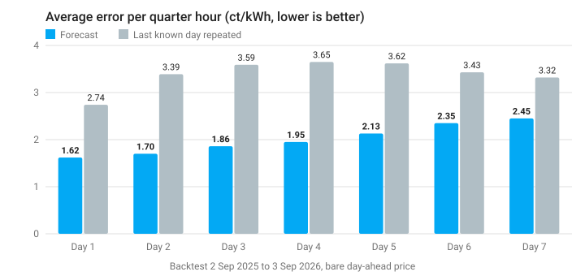

# Accuracy

The forecast is checked against the **published day-ahead prices**: every quarter hour that was forecast is later
compared with the price that was actually published.

| Forecast day | Forecast (ct/kWh) | Last known day repeated (ct/kWh) | Smaller error |
|---|---|---|---|
| 1 | 1.62 | 2.74 | 41 % |
| 2 | 1.70 | 3.39 | 50 % |
| 3 | 1.86 | 3.59 | 48 % |
| 4 | 1.95 | 3.65 | 47 % |
| 5 | 2.13 | 3.62 | 41 % |
| 6 | 2.35 | 3.43 | 31 % |
| 7 | 2.45 | 3.32 | 26 % |

These are mean absolute errors per quarter hour of the bare market price (before your formula), measured in a
backtest over one year (2 September 2025 to 3 September 2026). The simple alternative in the table is to assume
that the prices of the last known day repeat.

## What this means
- **The shape of the day is predictable.** Cheap and expensive hours are found well, which is what matters when
  you plan a battery, heat pump or boiler on the cheapest block.
- **The level is harder.** The average price level follows the gas price and the weather; the further ahead, the
  larger the error.
- **Not every period is equally easy.** In the autumn of 2026 gas prices doubled within a few months; in such a
  period the error is larger (about 2.8 ct/kWh for the first day) and the forecast tends to be a little too low.
  The band widens with the horizon to show this.

## The band
Every forecast quarter hour has a P10–P90 band, calibrated so that about 80 % of the actual prices fall inside
it. Use it to see how sure the forecast is, or to plan on the safe side, see
[Planning with the band](automations.md#planning-with-the-band).

## Check it yourself
The base controller has [accuracy sensors](entities.md#accuracy-sensors) with the live mean absolute error, bias
and band coverage over the most recent measuring period, so you can follow how well the forecast does on your
own installation.
