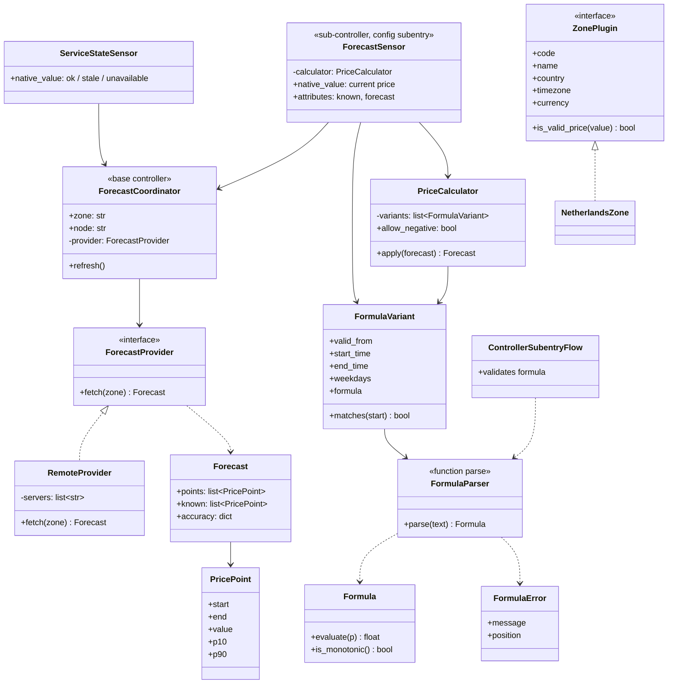
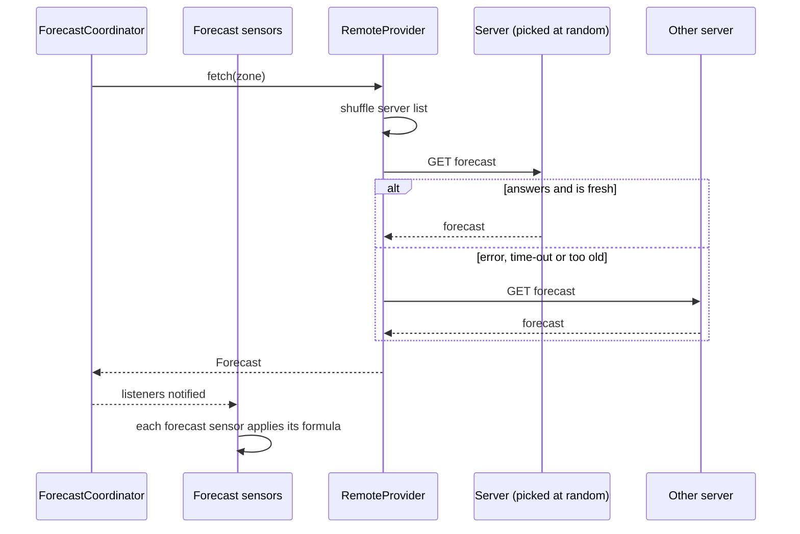
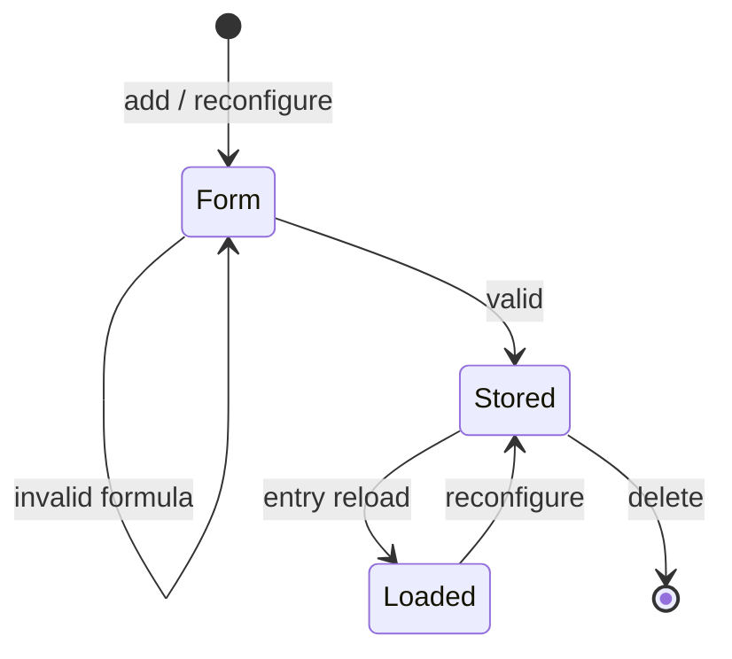

# Architecture

Code structure of the integration, as UML (Mermaid). The forecast itself is made by the forecast module of the
Lectoraat Smart Energie of MNEXT; the integration only reads it.

## Classes

## Refresh with failover

## Sub-controller lifecycle
A sub-controller is a config subentry of the base controller entry. The config flow offers *Add sub-controller*
(name, formula, "prices can be negative") followed by a menu to add variants (formula plus optional start date,
time range and weekdays) and finish; every formula is parsed when submitted and rejected when invalid or
decreasing. Variants are stored as JSON in the subentry and turned into `FormulaVariant` objects by the sensor. Changing a subentry reloads the entry, which rebuilds the sensors.

## Design patterns
| Pattern | Where |
|---|---|
| Strategy | `ForecastProvider`, `ZonePlugin` |
| Interpreter | `FormulaParser` |
| Facade | `ForecastCoordinator` (one refresh shared by all sub-controllers) |
| Chain of fallbacks | server list in `RemoteProvider`, shuffled per refresh (load spreading) |
