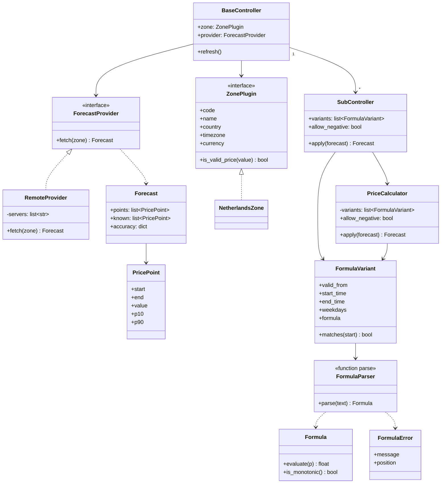
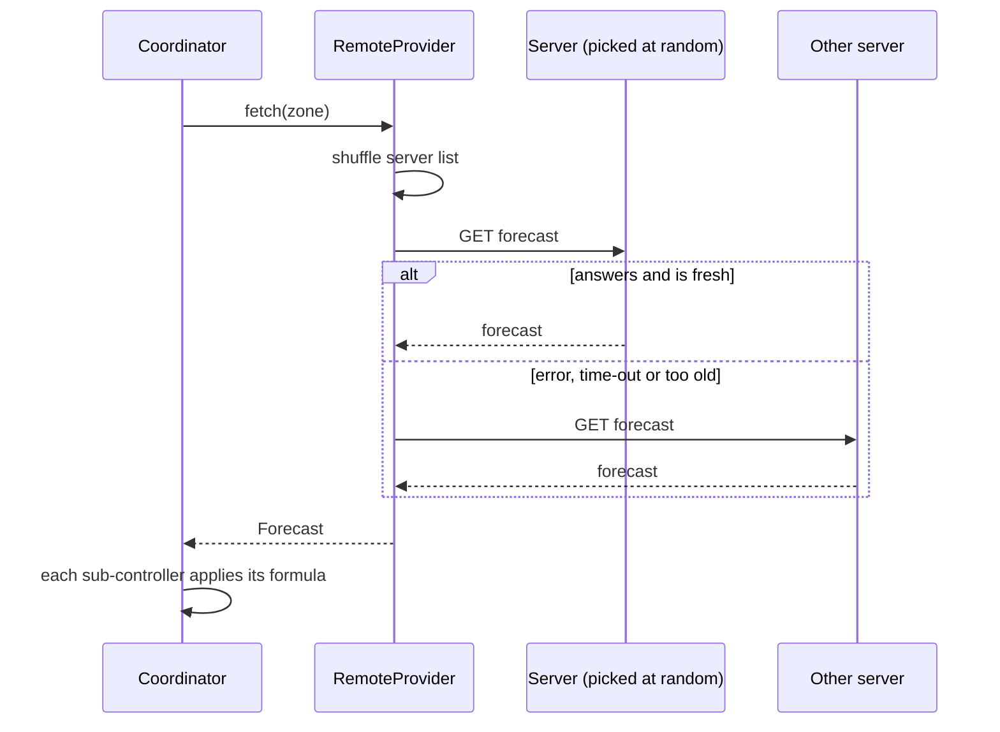

# Architecture

Code structure of the integration, as UML (Mermaid). The forecast itself is made by the forecast module of the
Lectoraat Smart Energie of MNEXT; the integration only reads it.

## Classes

## Refresh with failover

## Design patterns
| Pattern | Where |
|---|---|
| Strategy | `ForecastProvider`, `ZonePlugin` |
| Interpreter | `FormulaParser` |
| Facade | `BaseController` |
| Chain of fallbacks | server list in `RemoteProvider`, shuffled per refresh (load spreading) |
