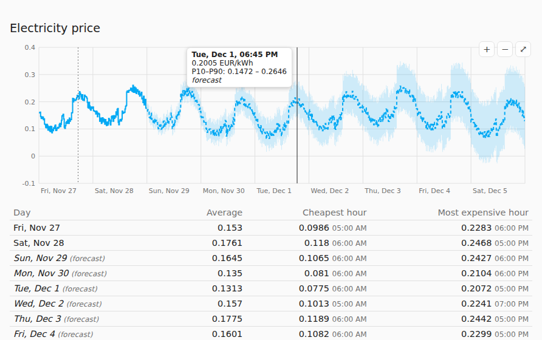
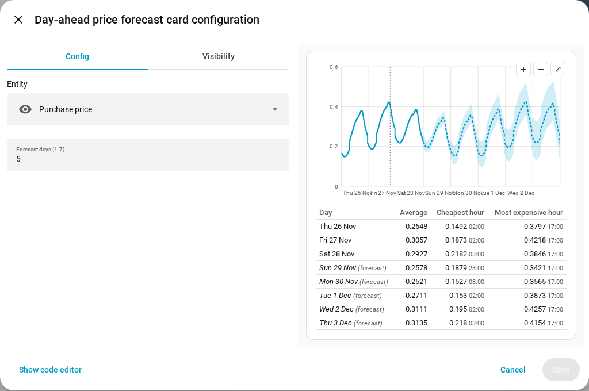
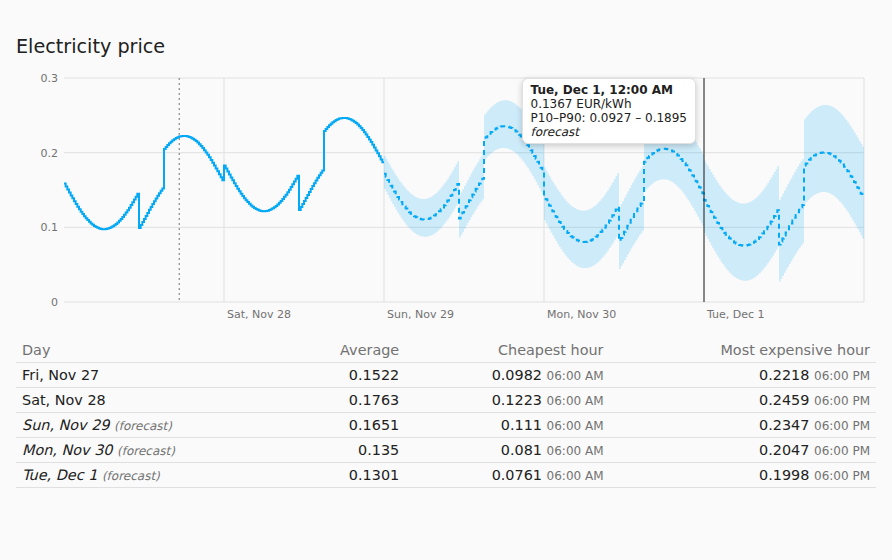
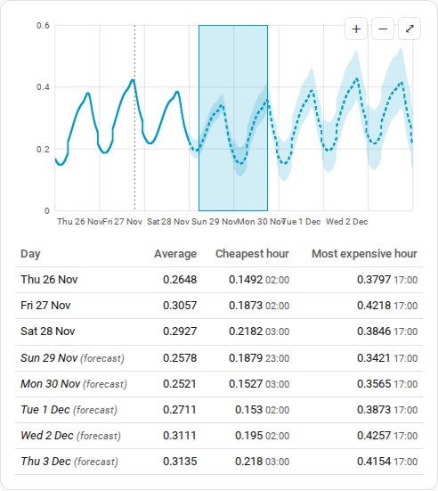
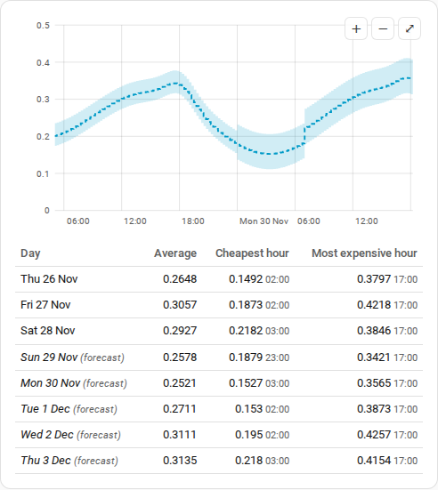

# Price chart card

The integration ships a Lovelace card that charts the quarter-hour prices of one forecast sensor
([sub-controller](configuration.md)): the published day-ahead prices as a solid line, followed by the forecast as
a dashed line with its P10–P90 band.



## Adding the card
The card is installed together with the integration; there is no resource to add by hand. After installing or
updating the integration, reload the browser page (hard refresh if the card does not show up).

1. Open a dashboard, choose **Edit dashboard** → **Add card**.
2. Pick **Day-ahead price forecast** from the list.
3. Choose the forecast sensor of the sub-controller you want to chart and the number of forecast days.



The price on the chart is whatever the formula of that sub-controller yields, so add one card per
sub-controller (purchase, feed-in, bare price, …).

Or in YAML:

```yaml
type: custom:day-ahead-price-forecast-card
entity: sensor.price_forecast
forecast_days: 5
```

## Options
| Option | Default | Description |
|---|---|---|
| `entity` | required | A forecast sensor of a sub-controller (a sensor with the `forecast` attribute). |
| `forecast_days` | `7` | Number of forecast days to show, 1 to 7. Forecast day 1 is the first day after the published day-ahead prices. The published prices are always shown in full. |
| `title` | none | Title above the chart. |
| `show_table` | `true` | Show the table with the average and the cheapest and most expensive hour per day. |

`forecast_days` counts calendar days after the last known price day: with `1`, the chart shows the published
prices plus the first day without published prices. The image below shows `forecast_days: 3`.



## Reading the chart
- **Solid line:** published day-ahead prices.
- **Dashed line:** the forecast (the median). It starts where the published prices end.
- **Shaded band:** the P10–P90 range of every forecast quarter hour; about 80 % of the actual prices fall inside it.
  The band widens the further ahead the forecast looks.
- **Hairline:** move the mouse over the chart (or touch and drag) and a vertical line follows it, snapping to
  the quarter hour under the pointer. A tooltip shows the start time, the price and, for forecast quarter hours,
  the P10–P90 range.
- **Now marker:** a vertical line at the current time.
- **Zoom and pan:** a quarter hour is only about a pixel wide when the whole range is shown. Zoom in to see the
  quarter-hour steps; the time axis then switches from days to hours and the price axis rescales to what is in
  view. See [Zooming and panning](#zooming-and-panning).
- **Table:** per day the time-weighted average price and the cheapest and most expensive clock hour, calculated
  from the quarter hours. Forecast days are marked.

The card follows your Home Assistant theme (light and dark) and is available in English and Dutch.

## Zooming and panning
Drag a box over the part you want to see; release the mouse button to zoom in on it:





| Action | Mouse | Touch |
|---|---|---|
| Zoom in or out | **+** and **−** buttons, or `Ctrl` (`⌘` on macOS) + mouse wheel around the pointer | **+** and **−** buttons, or pinch with two fingers |
| Zoom to an area | Drag a box over the part you want to see; release to zoom in on that time range | — |
| Pan | `Shift` + drag, or `Shift` + mouse wheel | Drag horizontally with one finger |
| Show everything again | The reset button, or double click | The reset button, or double tap |

- The plain mouse wheel is left to the dashboard, so the page still scrolls.
- You can zoom in to a window of 3 hours; you cannot move outside the shown range.
- The price axis follows the part that is in view. The table below the chart always covers the whole range.
- The zoom is kept while the data refreshes and resets when you change the card's entity or number of days.

## Troubleshooting
**The card is not in the card picker.** Reload the browser page; clear the cache if it still does not appear.
Check that the integration is set up.

**The card says the entity was not found or the chart is empty.** Choose a forecast sensor of a sub-controller,
not the service state sensor. The chart stays empty until the first forecast has been fetched; see the
[FAQ](faq.md).

**The chart still looks old after an update.** Hard-refresh the browser (or the Home Assistant app); the card file
is cached per version.
