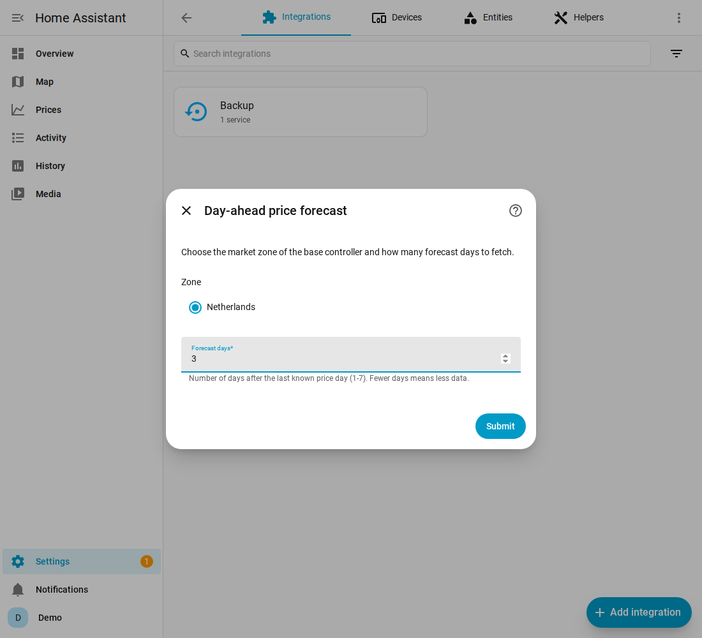
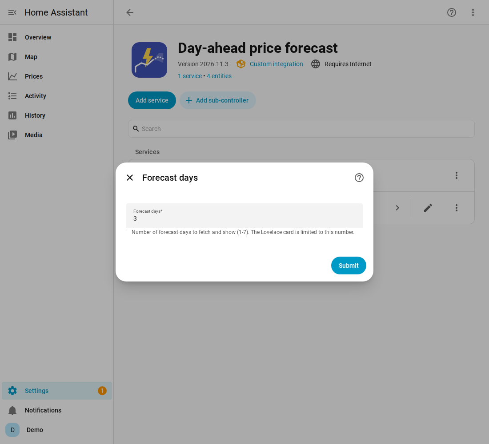
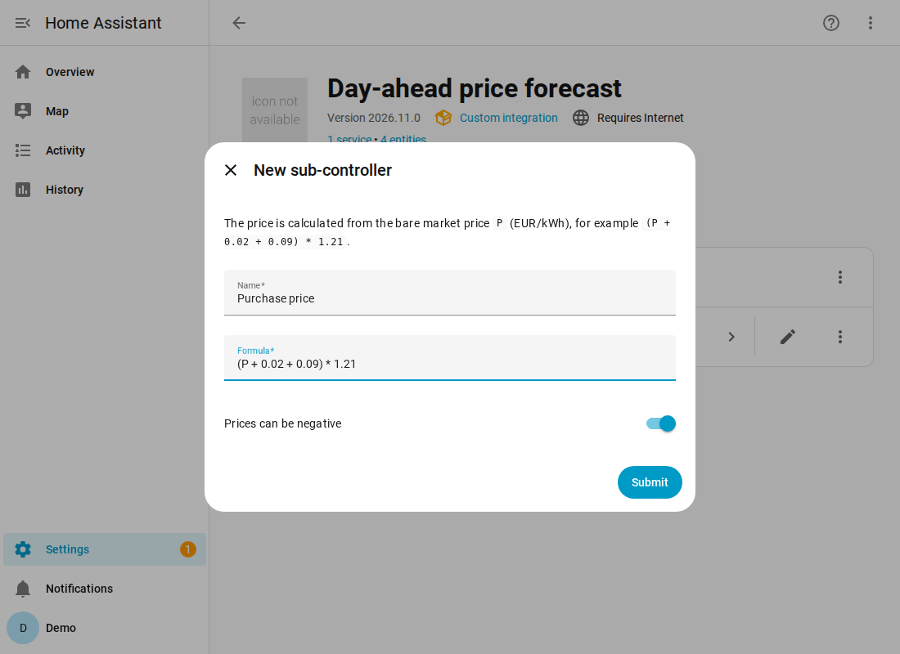
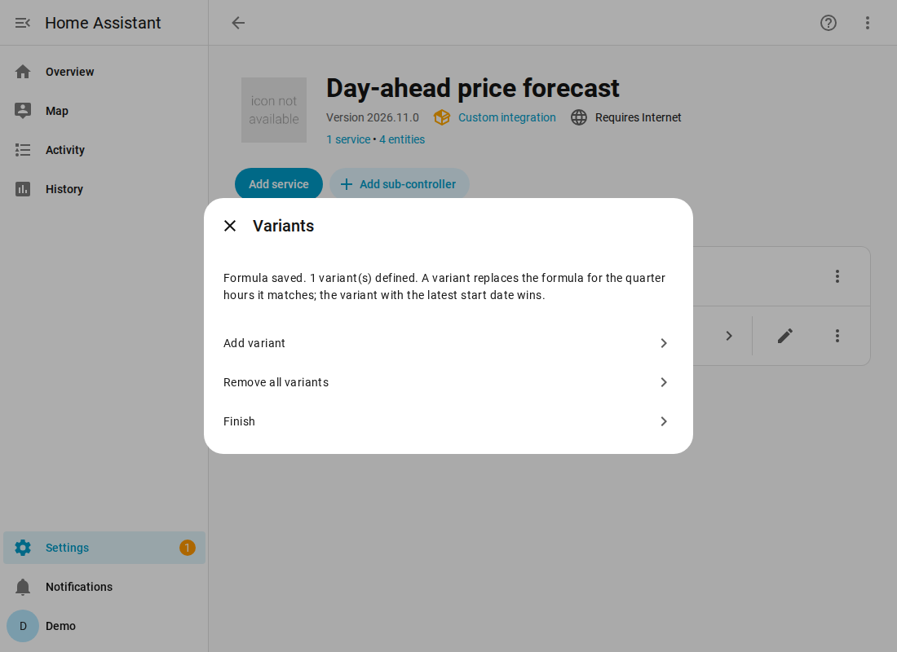
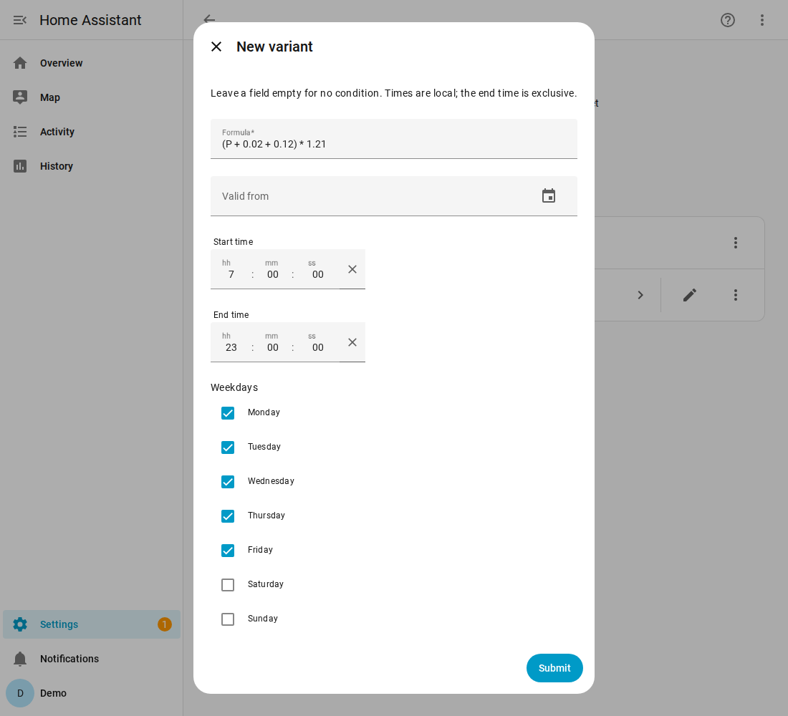

# Configuration

## Base controller
One per market zone. It refreshes the forecast every 30 minutes from the forecast service (failing over to the
second server) and provides the [service state and accuracy sensors](entities.md).

| Field | Meaning |
|---|---|
| Zone | the market zone, chosen when you add the base controller |
| Forecast days | how many forecast days to fetch and show, 1 to 7 (default 7) |

### Forecast days
Forecast day 1 is the first day after the published day-ahead prices. With fewer days the integration asks the
forecast service for less data (`days` query parameter) and the forecast sensors carry only those days. This saves
bandwidth and storage when you only need, for example, the next two days. Change it later with **Reconfigure** on
the integration page; the integration reloads. The [price chart card](card.md) cannot show more days than this.

## Sub-controllers
A sub-controller turns the bare market price `P` (EUR/kWh) into your own price with a formula and delivers a
[forecast sensor](entities.md#forecast-sensor). Add one with **Add sub-controller** on the integration page; edit
it later with **Reconfigure**. You can add as many as you like, for example one for purchase and one for feed-in.

| Field | Meaning |
|---|---|
| Name | name of the device and sensor |
| Formula | price calculation over `P`, see below |
| Prices can be negative | when off, results below zero are set to zero |

### Formulas
A formula uses `P`, numbers, `+ - * /`, parentheses and `min(...)` / `max(...)`.

| Formula | Meaning |
|---|---|
| `P` | the bare market price |
| `(P + 0.02 + 0.09) * 1.21` | add 2 ct supplier and 9 ct tax per kWh, then 21 % VAT |
| `P - 0.02` | feed-in with a 2 ct deduction |
| `max(P, 0) * 1.21` | never below zero before VAT |

- Use a decimal point or comma (`0.02`, `0,02`). Separate function arguments with `;` or a comma and a space:
  `min(P; 0.3)` or `min(P, 0.3)`. `min(1,5)` is the number 1.5 and therefore invalid.
- The formula must never decrease when `P` increases (for example `-P` or `1 - P` is rejected). This keeps the
  P10–P90 band valid after the calculation.
- The formula is checked when you submit the form; an error tells you when it cannot be used.

### Variants
Tariffs can change over time, for example dynamic grid tariffs from 2029. After saving a sub-controller, use
**Add variant** to define a formula that replaces the main formula for matching quarter hours.

| Field | Meaning |
|---|---|
| Formula | formula for this variant |
| Valid from | first date the variant applies; empty means always |
| Start time / End time | time of day (local), the end is exclusive; give both or neither. A range such as 22:00–06:00 spans midnight |
| Weekdays | days the variant applies; empty means every day |

When several variants match, the one with the latest *valid from* wins; on a tie, the one added last. If none
matches, the main formula applies. **Remove all variants** clears them again.

