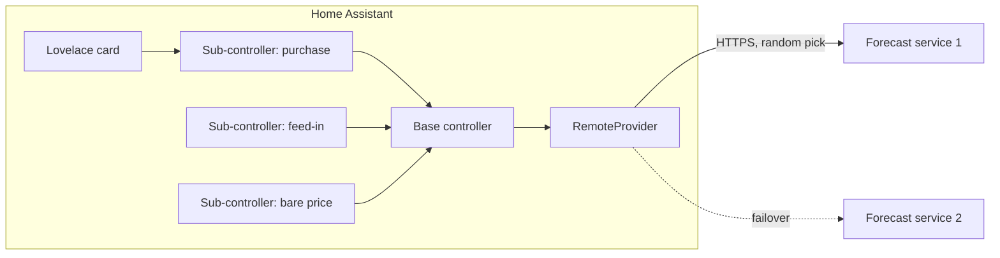

# Design: the integration, its controllers and the forecast service client

Status: **approved** (issue #2)

## Goal
A Home Assistant integration and Lovelace card that show the day-ahead electricity price per quarter hour (15 minutes) for the days
after the last known price day, with a P10–P90 band, as the price the user actually pays.

The forecast itself comes from the **forecast module of the Lectoraat Smart Energie of MNEXT**. The integration
is a client of that module; how the forecast is made is not part of this repository.

## Requirements
- A **base controller** per region (bidding zone). It reads the bare market price forecast `P` from the
  forecast service and supplies it to its sub-controllers.
- **Sub-controllers** (config subentries). Each has its own text formula over `P` and delivers its own
  forecast entity, for example `P`, `(P+0.0205+0.09174)*1.21` or `P-0.0205`.
- A formula can have **variants** by start date, time of day and weekday (for example dynamic grid tariffs
  from 2029). The variant with the latest valid start among the matching ones applies to each quarter hour.
- A per-controller switch "prices can be negative". Live validation of the formula in the form.
- Accuracy sensors on the base controller (MAE, bias, band coverage, in ct/kWh, bare price only), delivered by
  the service.
- A sensor with the state of the forecast service (reachable, which server, age of the forecast).
- A zone per country; the Netherlands first.

Out of scope: training or running a model inside Home Assistant, user price sensors as input, control of
devices.

## Time resolution
The unit of time is the **quarter hour**, as delivered by the service (96 per day, 92 or 100 on DST days). Formulas, variants (start date, time of day, weekday) and forecast entities work per quarter hour; per-hour or per-day figures (averages, cheapest hour) are derived from them.

## Forecast service client
The integration reads the forecast over HTTP from the forecast service. It has **two built-in server
addresses** (more may follow); for every refresh it picks one at random (which spreads the load over the servers) and falls back to the other one when a server does not
answer, answers with an error or serves a forecast that is too old. The addresses are constants of the
integration and are not user settings. Reading is read-only and needs no account.

The contract between integration and service (with a schema version in the response)
carries, per quarter hour: start, end, value, P10, P90 and the number of days ahead; the known prices up to now; the
state of the service; and the accuracy figures. All prices are bare market prices in EUR/kWh.

A request may carry the optional query parameter `days` (1 to 7, default all 7): the service then returns only the
forecast of that many calendar days after the last known price day, to save data. The number is a setting of the
base controller; see [the design of the forecast days setting](2026-11-28-forecast-days.md).

## Formulas
A recursive-descent parser in pure Python (never `eval`). Grammar: numbers (decimal comma or point), `P`,
`+ − * ×  /`, parentheses, unary minus, `min()` and `max()`. A formula must not decrease when `P` increases,
which keeps P10 ≤ value ≤ P90; it is evaluated three times (value, P10, P90).

## Entities
| Entity | Controller | Content |
|---|---|---|
| Forecast (sensor) | each sub-controller | current price; attributes with the quarter-hourly forecast and band |
| Accuracy sensors | base | MAE, bias, band coverage |
| Service state | base | reachable, server in use, age of the forecast |

## Code layout
`core/` is pure Python without Home Assistant imports and is tested with pytest: formula parser, variants,
forecast model objects. `providers/` holds the `RemoteProvider` (HTTP client with failover). `zones/` holds
one plugin per country. The Home Assistant layer (config flow, coordinator, entities) is thin.

## Testing
Unit tests for the parser (valid and invalid input, monotonicity), the variants and the failover logic with a
fake HTTP server; hassfest and HACS validation in CI on two Home Assistant versions.
