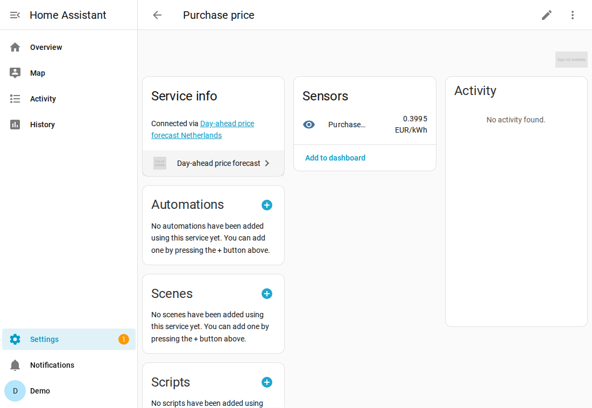
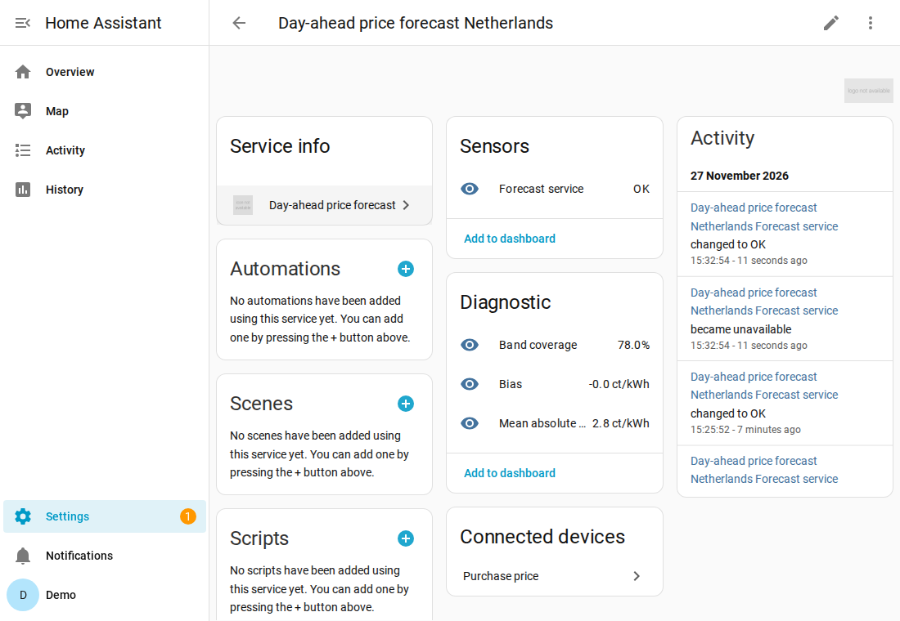

# Entities

## Forecast sensor
One per sub-controller. The state is the price of the current quarter hour in EUR/kWh, calculated with your
formula; it updates at every quarter hour. The attributes carry the whole series:



| Attribute | Content |
|---|---|
| `zone` | market zone, for example `NL` |
| `known_until` | end of the last published price day; the forecast starts here |
| `known` | published prices: `start`, `end`, `value` |
| `forecast` | 7 days of quarter hours: `start`, `end`, `value` (median), `p10`, `p90` |

The `known` and `forecast` attributes are not stored in the recorder database.

Example template giving the cheapest forecast quarter hour of the series:

```yaml
{{ state_attr('sensor.purchase', 'forecast') | sort(attribute='value') | first }}
```

## Service state sensor
On the base controller. State: `ok`, `stale` (the forecast is older than 3 hours) or `unavailable` (no server
answered). Attributes: `node` (which server answered), `created` and `age_minutes`.
Sub-controller sensors keep their last forecast while the service is down.



## Accuracy sensors
Diagnostic sensors on the base controller that show how far earlier forecasts were off, measured by the forecast
service over the last `hours` realised hours. They concern the **bare market price**, not your formula.

| Sensor | Unit | Meaning |
|---|---|---|
| Mean absolute error | ct/kWh | average size of the error |
| Bias | ct/kWh | average forecast minus actual; positive means too high |
| Band coverage | % | share of actual prices inside the P10–P90 band (about 80 % when calibrated) |

The state is the average over the forecast days; the attribute `per_day` has the value for each day (`"1"` is the
day after the last known price day) and `hours` the length of the measuring period. Without figures from the
service the state is *unknown*.
