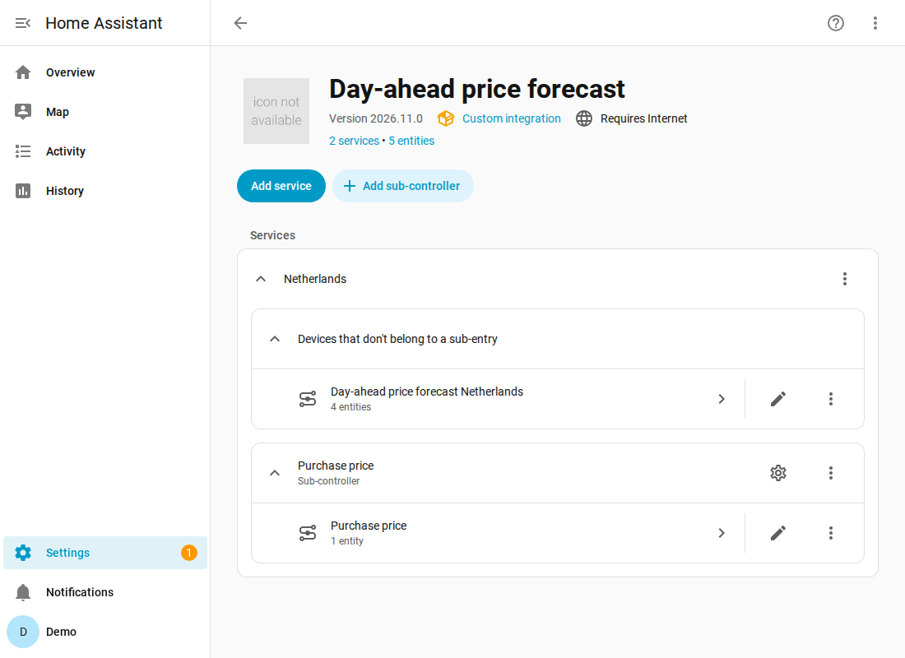

# Installation

## Requirements
- Home Assistant 2026.3 or newer.
- Internet access from Home Assistant to the forecast service. No account or API key is needed.

## Install from the Marketplace (Home Assistant 2026.11 and later)
The integration is in the Marketplace by default; there is nothing to add first.

1. Open *Settings → Marketplace* and search for **Day-ahead price forecast**.
2. Open it, select **Install**, check the version and select **Install** again.
3. Restart Home Assistant.

## Install with HACS (Home Assistant 2026.3 to 2026.10)
On these versions the Marketplace is not available; use HACS. The integration is in the default HACS catalog, so
no custom repository is needed.

1. Open HACS and search for **Day-ahead price forecast**.
2. Download it and restart Home Assistant.

## Set up
1. Go to **Settings → Devices & services → Add integration** and choose **Day-ahead price forecast**.
2. Choose the market zone (for now only the Netherlands). This creates the *base controller*: it fetches the
   bare market price forecast and shares it with all sub-controllers.
3. Add one or more [sub-controllers](configuration.md#sub-controllers) to get price entities.

Each zone can be added once.

## Show the forecast on a dashboard
The [price chart card](card.md) is installed with the integration. Add a sub-controller first, then add the card
to a dashboard and choose its forecast sensor. No resource has to be added by hand.

## Updating
The Marketplace (or HACS) shows the new version under *Settings → Updates*; install it and restart Home Assistant. Reload the browser page afterwards so the dashboard loads the new
version of the card.

