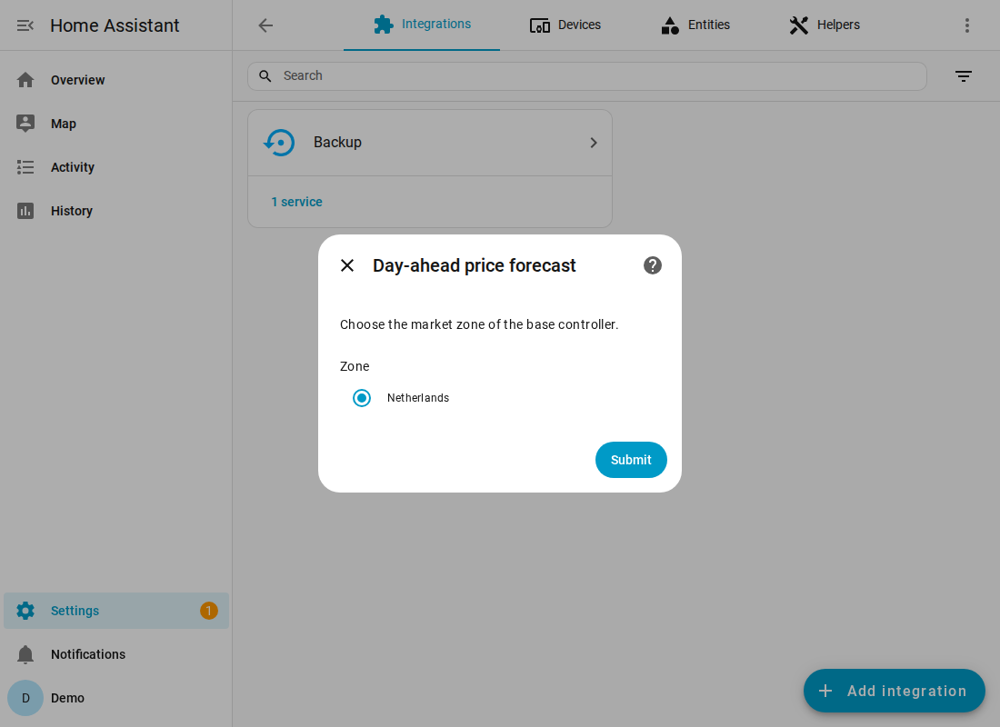

# Installation

## Requirements
- Home Assistant 2026.3 or newer.
- Internet access from Home Assistant to the forecast service. No account or API key is needed.

## Install from the Marketplace (Home Assistant 2026.11 and later)

1. *Settings → Marketplace*, upper right **Add from link** (the button above opens it).
2. Under *GitHub link* enter `abroeders/7day-ahead-price-forecast` and select **Add**; if asked for the type,
   choose *Integration* and select **Add** again.
3. Open **Day-ahead price forecast** and select **Install**, check the version, **Install**.
4. Restart Home Assistant.

The Marketplace needs a GitHub account connected to it (it asks for one the first time). The repository is not
in the Marketplace's own catalog yet, which is why it is added from its link.

## Install with HACS (Home Assistant 2026.3 to 2026.10)
1. Open HACS, choose **Custom repositories** and add `https://github.com/abroeders/7day-ahead-price-forecast`
   as category *Integration* (or use the button below).
2. Search for **Day-ahead price forecast**, download it and restart Home Assistant.

## Set up
1. Go to **Settings → Devices & services → Add integration** and choose **Day-ahead price forecast**.
2. Choose the market zone (for now only the Netherlands). This creates the *base controller*: it fetches the
   bare market price forecast and shares it with all sub-controllers.
3. Add one or more [sub-controllers](configuration.md#sub-controllers) to get price entities.

Each zone can be added once.

## Show the forecast on a dashboard
The [price chart card](card.md) is installed with the integration. Add a sub-controller first, then add the card
to a dashboard and choose its forecast sensor. No resource has to be added by hand.

## Updating
The Marketplace (or HACS) shows the new version under *Settings → Updates*; install it and restart Home Assistant. Reload the browser page afterwards so the dashboard loads the new
version of the card.

